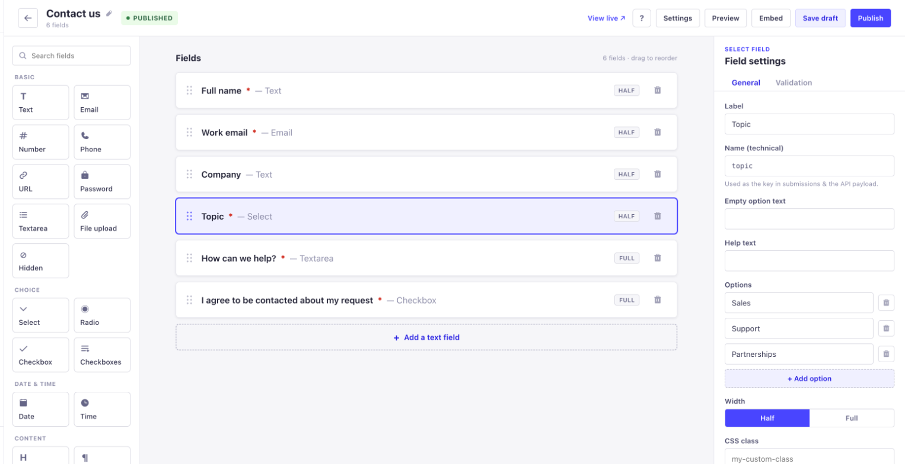
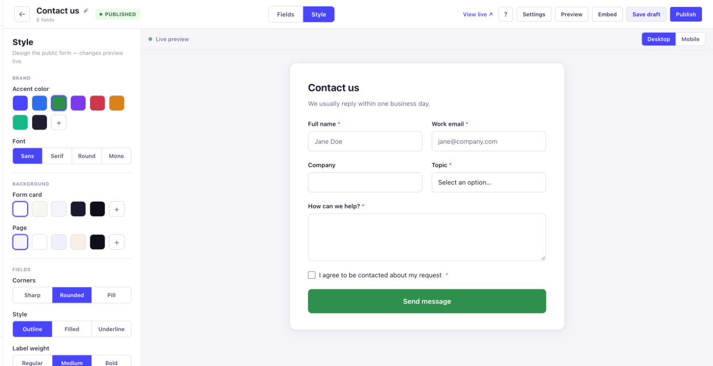
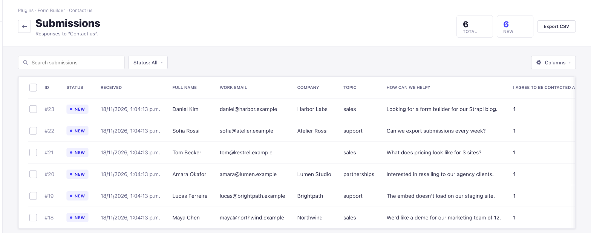

<p align="center">
  
</p>

<h1 align="center">Strapi Form Builder</h1>

[](https://www.npmjs.com/package/strapi-plugin-form-builder-cms)
[](https://www.npmjs.com/package/strapi-plugin-form-builder-cms)
[](https://opensource.org/licenses/MIT)
[](https://strapi.io)

A visual drag-and-drop form builder plugin for [Strapi 5](https://strapi.io). Create, publish and embed forms on any website without writing a single line of backend code.



---

## Features

- **Drag-and-drop builder**: reorder fields visually inside the Strapi admin.
- **Starter templates**: begin from Contact, Newsletter, Feedback, Job application, Event RSVP, or a blank form.
- **Rich field types**: text, email, number, phone, URL, password, date, time, textarea, file upload, select, radio, checkbox, checkbox-group, hidden, heading, paragraph, divider.
- **Field validation**: required, minLength, maxLength, min value, max value, email, URL and regex pattern, all configurable per field with custom error messages.
- **File uploads**: allowed types, size and number of files per field, checked by file signature and stored in the Media Library. Private upload providers get signed links.
- **Draft / Publish**: draft edits stay private; the public page and embed always serve the last **published** version, so saving a draft never affects the live form.
- **Public page**: one toggle generates a hosted page at `/api/strapi-plugin-form-builder-cms/page/:slug` (available once the form is published).
- **Embed script**: a single `<script>` tag renders the form on any external site with zero dependencies.
- **Spam & limits**: honeypot field plus optional per-IP hourly rate limiting.
- **CAPTCHA**: optional Cloudflare Turnstile or Google reCAPTCHA v2 per form, verified server-side (fail-closed). The secret key never reaches the browser.
- **Hidden tracking fields**: capture UTM parameters, referrers or campaign IDs from the page URL into every submission.
- **Visual style editor**: a dedicated Style mode with a live Desktop/Mobile preview for accent, fonts, backgrounds, corners, field & button styles, spacing, shadow, card border and placement, plus editable colour palettes. No CSS required; changes follow draft / publish.
- **Submission inbox**: search, filter by status (new / read / archived), bulk mark-as-read / archive / delete, per-form column picker, a detail drawer with next/previous navigation, and CSV export.
- **Form preview**: preview the rendered form inside the admin before publishing.
- **Admin in 6 languages**: English, Spanish, French, German, Arabic and Turkish.





---

## Requirements

| Dependency | Version |
|---|---|
| Strapi | `^5.0.0` |
| Node.js | `>=18.0.0` |
| React | `^18.0.0` |

---

## Installation

```bash
# npm
npm install strapi-plugin-form-builder-cms

# yarn
yarn add strapi-plugin-form-builder-cms
```

### Enable the plugin

Add the plugin to your Strapi configuration:

```js
// config/plugins.js  (or config/plugins.ts)
module.exports = {
  'strapi-plugin-form-builder-cms': {
    enabled: true,
  },
};
```

### Rebuild and restart

```bash
npm run build
npm run develop
```

The **Form Builder** entry will appear in the Strapi admin sidebar.

### Admin languages (optional)

The plugin's admin UI ships in English, Spanish, French, German, Arabic and Turkish. Strapi only loads English unless you enable more languages in `src/admin/app.tsx` (or `app.js`):

```ts
export default {
  config: {
    locales: ['es', 'fr', 'de', 'ar', 'tr'],
  },
};
```

Rebuild the admin, then each user picks their language under **Profile → Interface language**.

---

## Quick start

### 1. Create a form

1. Open **Form Builder** in the sidebar.
2. Click **Create form** and pick a starter template or a blank form.
3. Click field types in the left palette to add them to the canvas, then drag to reorder.
4. Click any field to open its settings panel, with **General** (label, name, placeholder, required, width) and **Validation** tabs.
5. Click **Save draft** to persist without affecting the live form, or **Publish** to update what the public sees.

### 2. Embed it on your website

Open the form and click the **Embed** button to copy the snippet:

```html
<div id="sfb-form-{id}"></div>
<script
  src="https://your-strapi-domain.com/api/strapi-plugin-form-builder-cms/embed.js"
  data-form-id="{id}"
  async
></script>
```

Paste both tags wherever you want the form to appear. The script is self-contained: no external dependencies, no build step required.

Prefer a link? Toggle **Public page** in the form settings and publish. The form gets its own hosted page:

```
https://your-strapi-domain.com/api/strapi-plugin-form-builder-cms/page/{slug}
```

> The public page, embed and submit endpoint only serve **published** forms. An unpublished (draft) form returns `404`.

### 3. View submissions

Click **Submissions** on any form from the list page. Search, filter by status, and pick which columns to show. Open a submission for a detail drawer with next/previous navigation; mark as read, archive or delete, individually or in bulk. Export everything to **CSV**.

---

## Documentation

- [Fields and validation](https://github.com/devCluna/strapi-plugin-form-builder-cms/blob/main/docs/fields.md): every field type, file uploads and validation rules.
- [Form settings](https://github.com/devCluna/strapi-plugin-form-builder-cms/blob/main/docs/settings.md): settings, CAPTCHA and hidden tracking fields.
- [Styling](https://github.com/devCluna/strapi-plugin-form-builder-cms/blob/main/docs/styling.md): the visual style editor and overriding styles from your own site.
- [Public API](https://github.com/devCluna/strapi-plugin-form-builder-cms/blob/main/docs/api.md): routes, submit payload and responses, to build your own form UI.
- [Contributing](https://github.com/devCluna/strapi-plugin-form-builder-cms/blob/main/CONTRIBUTING.md): local development and tests.

---

## Roadmap

- [x] Export submissions as CSV
- [x] CAPTCHA / spam protection (Cloudflare Turnstile · reCAPTCHA v2)
- [x] Hidden tracking fields (UTM / referrer capture)
- [x] Visual style editor (theming, live preview)
- [x] File upload field type
- [ ] Email notifications on new submission
- [ ] Multi-step / wizard forms
- [ ] Webhook on submit
- [ ] Version history / restore

Have a feature request? [Open an issue](https://github.com/devCluna/strapi-plugin-form-builder-cms/issues).

---

## License

[MIT](https://github.com/devCluna/strapi-plugin-form-builder-cms/blob/main/LICENSE)

---

## Author

**dev.cluna**: [dev.cluna@gmail.com](mailto:dev.cluna@gmail.com)
